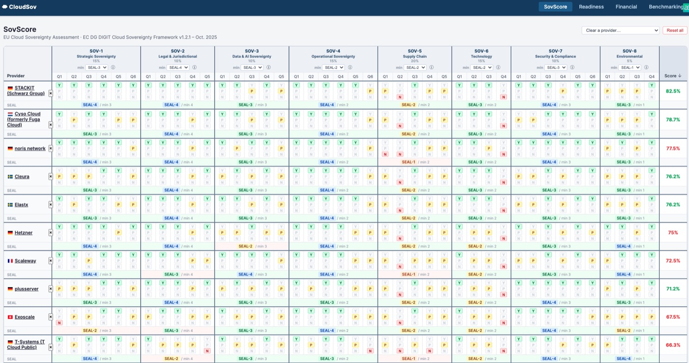
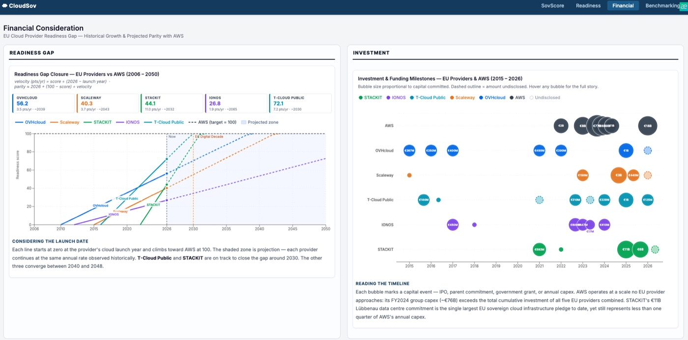
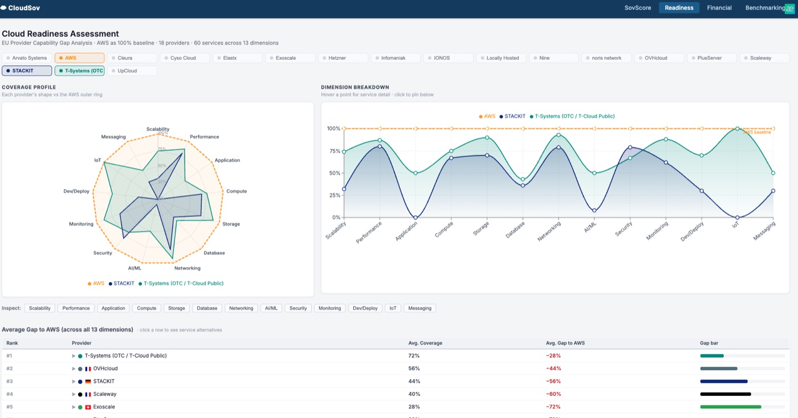

<a href="https://ihonosetale.eu">
  <picture>
    <source media="(prefers-color-scheme: dark)" srcset="assets/header-dark.svg">
    
  </picture>
</a>

  
  
  
  

<picture>
  <source media="(prefers-color-scheme: dark)" srcset="assets/stats-dark.svg">
  
</picture>

## 👋 Hi there

I'm a **mechanical engineer turned software engineer**, and I like problems where code meets the physical world: devices, sensors, robots, and the people who use them.

For three years I built **production web and mobile apps** at Zettaworks, from payment flows used by thousands of people to a **fraud detection system** I led with a team of four. Since 2025 I've been at **Alps Alpine in Munich**, building the automated test benches, robot integrations and tools that validate IoT products on every firmware release. Alongside that, I research **European cloud sovereignty** and write about what I learn on my [blog](https://ihonosetale.eu/blog).

## 🧭 Four sides of my work

<picture>
  <source media="(prefers-color-scheme: dark)" srcset="assets/roles-dark.svg">
  
</picture>

| | Highlights | Stack |
|---|---|---|
| 🧪 **Test automation** | Remote-controlled test benches for IoT trackers and cameras · UR5 cobot that validates IMU sensors · CRA security testing | Python · pytest · C++ · Arduino · QMetry · Jenkins |
| 💻 **Full-stack** | E-wallets, payments, real-time chat · iOS and Android apps in production · internal tools on AWS | Django · FastAPI · React · React Native · PostgreSQL |
| 🧠 **Machine learning** | Fraud detection for a payments app · production ML pipeline · disease risk prediction | PyTorch · TensorFlow · OpenCV · pandas |
| 🦾 **Robotics** | UR5 driver integration · vision-guided Omron cobot · kinematics · [CAD designs](https://grabcad.com/ihonosetale.oseghale-1) | Python · Universal Robots · SolidWorks · Fusion 360 |

## ⭐ Featured: CloudSov

**How sovereign is your cloud provider, really?** CloudSov scores **17 European cloud providers** against the European Commission's Cloud Sovereignty Framework, maps their coverage of **60 AWS services**, benchmarks their performance, and projects when each could catch up with AWS. Built as part of my published research on EU cloud sovereignty for Alps Alpine and Technische Hochschule Rosenheim.

<table>
  <tr>
    <td width="50%"></td>
    <td width="50%"></td>
  </tr>
</table>

  <a href="https://cloudsov.ihonosetale.eu"><b>Try it live →</b></a> &nbsp;·&nbsp;
  <a href="https://github.com/aaeu-ihono/cloudsov-tool">Source code</a> &nbsp;·&nbsp;
  <code>Python</code> <code>FastAPI</code> <code>React</code> <code>Recharts</code>

## 🚀 Shipped to real users

| Product | What it does | Links |
|---|---|---|
| **Qomuniti** | Estate management: e-wallet, chat, visitor access, emergency alerts · **5,000+ residents** | [Website](https://qomuniti.com) · [App Store](https://apps.apple.com/za/app/qomuniti/id1630100803) |
| **Cashpoint** | Payments for airtime, bills, TV subscriptions and flights · **12,000+ users** | [App Store](https://apps.apple.com/app/cash-point/id6474533330) · [Google Play](https://play.google.com/store/apps/details?id=com.cashpointbills.cashpointbills) |
| **Perra.io** | Crypto and gift card trading with fast KYC onboarding | [Website](https://perra.io) |
| **Disease prediction** | ML models estimating diabetes, breast cancer and Parkinson's risk | [Live demo](https://hospital.streamlit.app/) |
| **Solutions.help** | Volunteer fundraising platform connecting low-income communities with donors · **$10,000+ raised** | |

## ✍️ Latest writing

<!-- BLOG-POST-LIST:START -->
Articles and tutorials are on their way: follow along at **[ihonosetale.eu/blog](https://ihonosetale.eu/blog)** or subscribe to the [RSS feed](https://ihonosetale.eu/rss.xml).
<!-- BLOG-POST-LIST:END -->

## 🔨 Currently building

- **LLM test assistant** that generates test cases from requirements and clusters failures from logs
- **Production ML system** with model serving, experiment tracking and drift monitoring
- **ROS 2 pick-and-place** driven by natural-language commands, in simulation

## 🛠️ Tools I reach for

  

<b>🎓 Education & certifications</b>

 

- **M.Sc. Advanced Industrial Engineering**, Technische Hochschule Rosenheim (2024 – 2026) · grade 1.7
- **B.Eng. Mechanical Engineering**, Ambrose Alli University · CGPA 4.16 / 5.00
- [Data Structures and Algorithms](https://certificate.algoexpert.io/AE-c0448b0171) (AlgoExpert) · [Python Professional](https://www.hackerrank.com/certificates/5636a57e6bd0) (HackerRank)
- 🌍 English (fluent) · German (B1, working towards B2)

<picture>
  <source media="(prefers-color-scheme: dark)" srcset="assets/footer-dark.svg">
  
</picture>

  <b>Let's build something that works in the real world.</b> 
  <a href="https://ihonosetale.eu">ihonosetale.eu</a> · <a href="https://www.linkedin.com/in/ihonomic">LinkedIn</a> · <a href="mailto:contact@ihonosetale.eu">contact@ihonosetale.eu</a>

